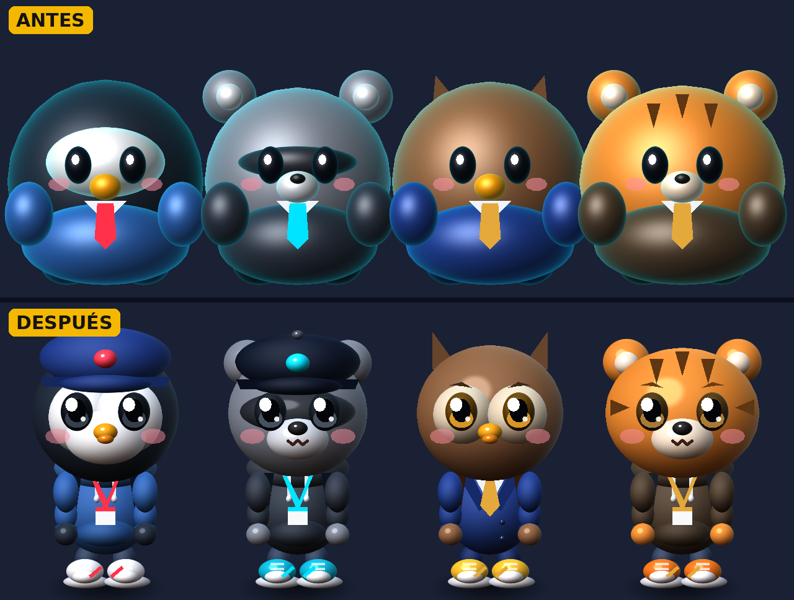
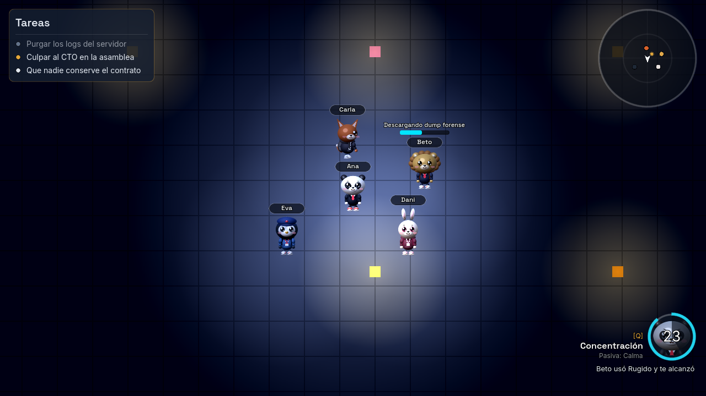
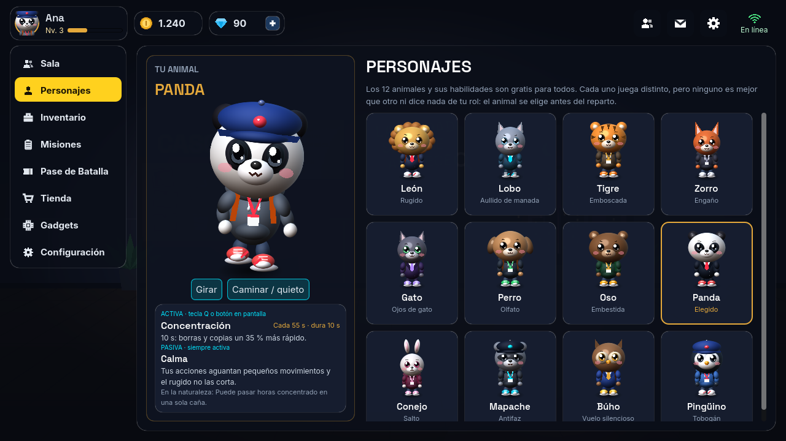
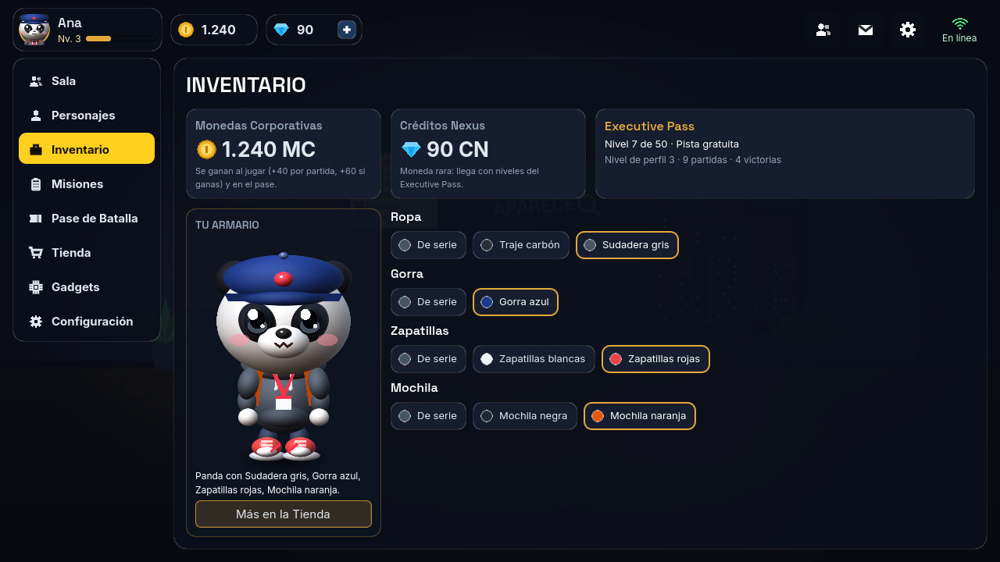

# Entrega: lobby nocturno, avatares y habilidades por animal

Estado al 11 de octubre de 2026. Todo está probado:

- 46 pruebas del servidor;
- las 8 suites del cliente;
- una partida completa con 4 bots, en la que los cuatro llegaron al veredicto.

## 1. Lobby y menú

- **Sala de espera:** oficina de detective de noche con la tarjeta del código y el botón **Compartir**. Debajo del selector de tipo de caso están **Opciones** e **INICIAR**.
- **INICIAR** marca que estás listo. La partida empieza cuando todos lo están, y las salas públicas arrancan solas tras una cuenta atrás.
- **Tipo de caso:** solo **Fraude** está activo, porque es el único caso que existe. Secuestro, Infidelidad, Robo e Investigación salen como "Pronto" hasta que tengan su caso.
- **Lista de jugadores:** muestra nombre, animal y si está listo, nunca el rol.
- **Pantallas pendientes:** Correo, Amigos y Gadgets están como "Próximamente".
- **Decisiones que tomé por defecto:**
  - cada jugador elige su animal;
  - la capacidad de la sala la marca el caso (4 jugadores en Fraude);
  - el perfil se guarda con un identificador local, porque todavía no hay cuentas.

## 2. Avatares chibi

- **Cambios:** proporciones nuevas, codos y antebrazos, zapatillas con suela y cordones, mochila, ojos con brillos, material satinado y sombra ovalada en el suelo. Los antes y después están en `ui/chibi_antes_despues.png` y `ui/chibi_catalogo_antes_despues.png`.
- **Límites:** los personajes siguen siendo procedurales en 2.4D, piezas planas con un shader que simula volumen. No son un render 3D ni igualan una ilustración profesional. Si algún día hay arte final, el juego ya acepta hojas PNG por animal en `client/assets/sprites/skins/<animal>/`.
- **Rendimiento:**
  - Un chibi en vivo cuesta unas 60 llamadas de dibujo. Con 12 en pantalla salen 715 llamadas por frame y 0,12 ms de CPU, medido en el escritorio.
  - Para móvil, `ChibiBaker` dibuja cada animal una vez en una hoja de 25 poses y luego lo pinta como una sola textura: 1 llamada por chibi.
  - A cambio, el chibi horneado pierde el parpadeo, la respiración y el muelle de las orejas.
  - Se cambia en Configuración → Calidad de los avatares.
  - **No lo he medido en un teléfono real**, así que los 60 FPS en móvil están por confirmar.

## 3. Habilidades por animal

- **Cada animal:** tiene una pasiva y una activa. La activa se usa con la tecla **Q** o con el botón redondo, que muestra la recarga en segundos.
  - La tabla completa de los 12 animales está en `ROADMAP_EXPANSION.md`.
  - La misma sección, "SISTEMA DE HABILIDADES TÁCTICAS POR ANIMAL", está en el apartado 3.6 de `DOCUMENTO_TECNICO_PROPIEDAD_INTELECTUAL.md`.
- **Por qué no revelan roles:**
  - el animal se elige en la sala, antes del reparto;
  - las habilidades solo tocan movimiento, barras de acción, inventario y escondites que ya podías ver;
  - las secretas (Vuelo silencioso, Engaño, Ojos de gato, Olfato y Antifaz) solo las sabe quien las usa.
- **Validación en el servidor:** fase, enfriamiento y cada efecto. Si el archivo trae números fuera de rango, el servidor no arranca.
- **Partida con 4 bots:**
  - el león rugió, el perro olió un escondite, el zorro se disfrazó y el panda se concentró;
  - nadie vio las secretas de otro;
  - el segundo uso seguido se rechazó por recarga;
  - fuera de la investigación, el uso también se rechazó.

## 4. Economía: animales gratis, solo cosméticos

- **Animales:** los 12 son gratis para todos. Los perfiles antiguos se migran solos y reciben los 12.
- **Tienda y Executive Pass:** solo ofrecen cosméticos (8 prendas de ropa, 4 gorras, 5 zapatillas y 4 mochilas) y monedas del juego. No hay pagos con dinero real.
- **Inventario:** ahora es un armario para ponerte y quitarte lo que tienes. En la sala, los demás ven tu ropa al momento.
- **Corbata:** los cosméticos nunca la tocan, porque en tu pantalla lleva el color de tu rol.

