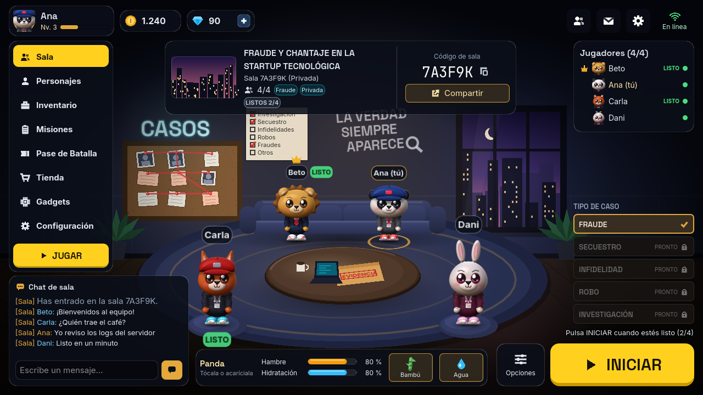
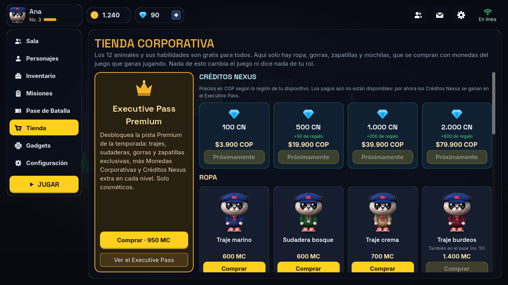
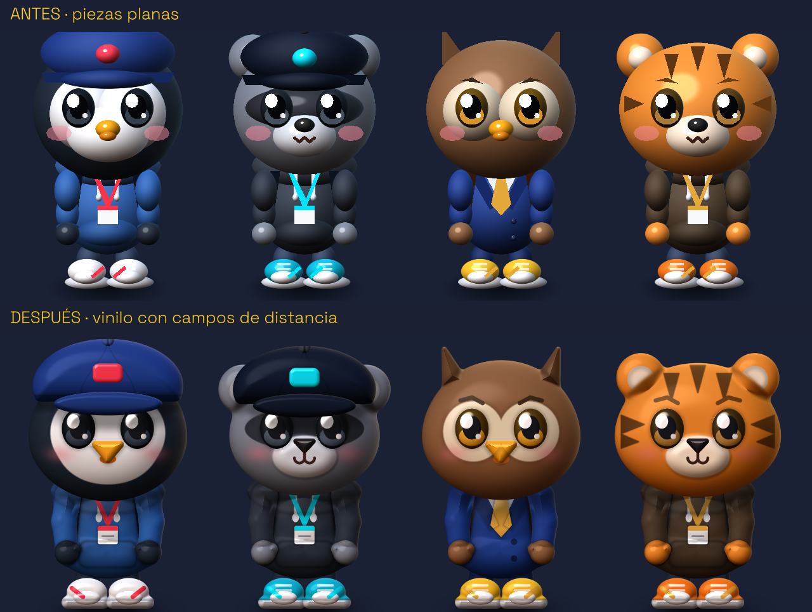
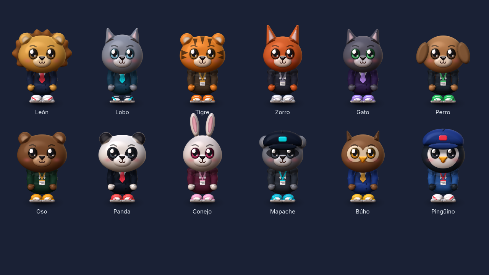
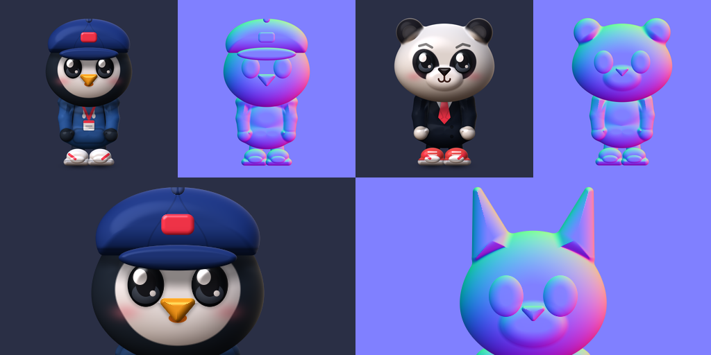
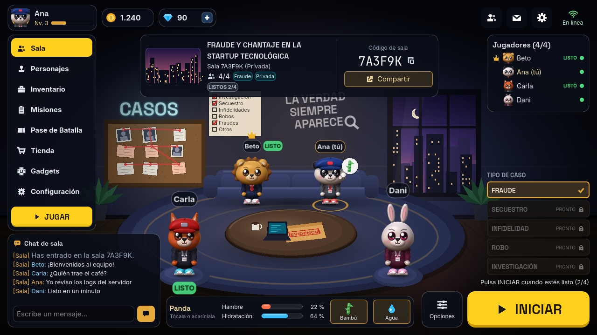
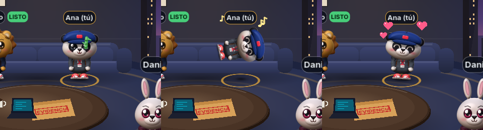
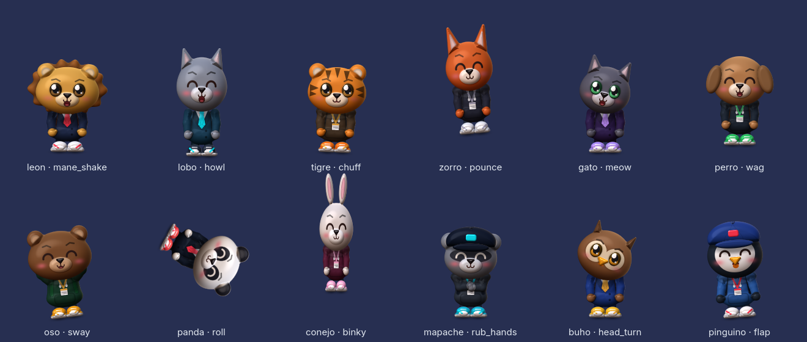
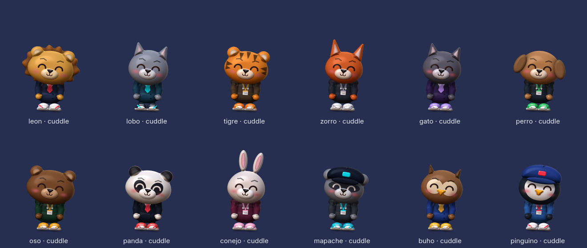
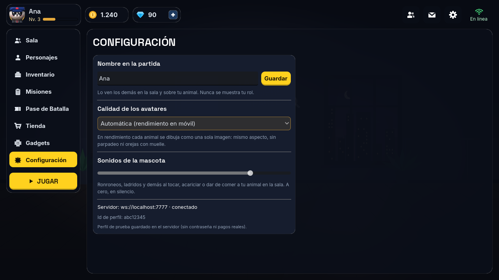

# Entrega: chibis de vinilo, mascota del lobby y servidor de producción

Estado al 11 de octubre de 2026. Todo está probado:

- **Servidor:** 47 pruebas, incluida la nueva del health check.
- **Cliente:** las 12 suites. Cuatro son nuevas:
  - `StorePricesTest`
  - `ServerUrlTest`
  - `PetCareTest`
  - `PetLobbyTest`, que hace clics de verdad sobre la interfaz.
- **Partida completa con 4 bots** (león, perro, zorro y panda): los cuatro llegaron al veredicto.

## 1. Botones, sala y precios

| Botón | Qué envía |
|---|---|
| **JUGAR** / **Partida rápida** | `queue_match` (cola pública) |
| **Crear sala privada** | `create_room` (alias `CREATE_PRIVATE_ROOM`); al llegar el "welcome" se ve la sala con su código |
| **Unirse** | `join_room` con el código de 6 caracteres |
| **INICIAR** (en la sala) | marca "listo"; la partida empieza cuando todos lo están |

- **Sin conexión:** cada botón conecta primero. Si no hay servidor, lo explica.
- **Capturas del flujo:** `ui/flujo_cola.png`, `ui/flujo_sala_creada.png` y `ui/flujo_sin_servidor.png`, este último con el servidor local apagado.
- **Sofá:** ahora es bajo y está al fondo, así que el ventanal, el tablero CASOS y el lema se ven enteros. Asientos, pufs y mesa se ordenan por profundidad.

**Precios por región:**

- El precio base va en USD. Si la región del dispositivo es Colombia (`es_CO`), sale en pesos: por ejemplo, 4,99 USD se muestra como $19.900 COP.
- La tabla está en `client/data/store/store_prices.json`.
- Es solo informativa: el botón dice "Próximamente".
- Para cobrar en Android hay que integrar **Google Play Billing** y dar de alta los productos en Play Console. En iOS haría falta la App Store.

| USD (`ui/menu_tienda.png`) | COP (`ui/menu_tienda_cop.png`) |
|---|---|
|  |  |

## 2. Chibis "vinyl toy"

- **Cómo se dibujan:** cada animal es ahora un solo rectángulo con un shader de campos de distancia (`client/shaders/chibi_sdf.gdshader`).
- **Silueta:** cabeza, orejas, cuerpo, brazos, piernas, zapatillas, cola, mochila y gorra se funden en una silueta orgánica, sin contornos ni costuras.
- **Volumen y luz:**
  - Volumen inflado de vinilo y oclusión suave entre piezas.
  - Sombra de contacto difusa en el suelo.
  - Luz de estudio satinada: difusa envolvente, brillo de caja de luz y luz de borde cálida.
- **Bordes:** antialias a cualquier escala, sin dientes de sierra.
- **Color en tu PC:** con Forward+ (HDR 2D), los colores se calculan en sRGB y se pasan a lineal al final. Antes salían lavados.
- **Horneado para móvil:**
  - La hoja se hornea a 1,75× con mipmaps.
  - Se corrigió un fallo por el que el resplandor del ambiente se aplicaba dos veces y la hoja salía más clara.
  - Horneado y en vivo ahora se ven idénticos.
- **Sprites HD:** los 12 animales a 512×512, cada uno con su mapa de normales (24 PNG en `client/assets/sprites/hd/`). El juego no los usa: son para la tienda de apps, la prensa y el registro de la obra.

**Límites, con honestidad:**

- Sigue siendo arte procedural hecho con código. No es una ilustración pintada a mano ni un render 3D.
- Los 512×512 salen del mismo shader, no de un redibujo artístico.
- No lo he medido en un teléfono real. El dibujo en vivo cuesta más GPU por píxel que antes, y por eso en móvil se usa el horneado.

## 3. Mascota del lobby (Alter Ego)

- **Barras de Hambre e Hidratación:**
  - Bajan con el tiempo, también con el juego cerrado: 12 h y 8 h de llena a vacía.
  - Por debajo del 30 % parpadean en rojo y la mascota piensa en lo que le falta, con un bocadillo sobre la cabeza.
  - Se guardan en el dispositivo, aparte para cada perfil.
- **Comida según la especie:**
  - león: filete; lobo: hueso carnoso; tigre: carne; zorro: bayas silvestres;
  - gato: pescado; perro: croquetas; oso: miel; panda: bambú;
  - conejo: zanahoria; mapache: uvas; búho: grillos; pingüino: arenque.
  - Cada comida suma 35 puntos y el agua, 40. Si ya está lleno, niega con la cabeza.
  - Todo es gratis y no cambia nada en la partida.
- **Tocar y acariciar:**
  - Un toque o clic hace la reacción propia de cada animal.
  - Arrastrar el dedo o el ratón por encima es una caricia: cierra los ojos de gusto, se arrima y salen corazones.
  - Tu animal se dibuja siempre en vivo para poder poner caras.

**Sonidos:**

- Hay 27 archivos: uno al tocarlo y otro al acariciarlo para cada animal, más comer, beber y "lleno".
  - Al tocarlo: ladridos, maullido, aullido, balido del panda, "hu-huu" del búho...
  - Al acariciarlo: ronroneos y otros sonidos más bajitos.
- **Origen:** los genera el script del proyecto `client/tools/gen_pet_sfx.py`, por síntesis, sin grabaciones ni muestras de terceros. Son obra tuya, como el resto del código.
- **Licencia:** está todo en `client/assets/audio/pets/LICENCIA.md`.
- **Límite:** son aproximaciones sintéticas, no grabaciones reales de animales. Para más realismo se pueden cambiar por grabaciones CC0 con el mismo nombre de archivo, apuntando su origen.
- **Volumen:** en Configuración → Sonidos de la mascota.

## 4. Servidor de producción

- **Cliente:**
  - Se conecta por defecto a `wss://bajo-sospecha.onrender.com`.
  - Para probar en local: `-- --local`, `--server=<url>` o la variable `SERVER_URL=local`.
  - Espera hasta 75 s, porque el plan gratuito de Render duerme el servidor, y avisa de que puede tardar un minuto.
  - Arreglé un fallo de este cambio que habría roto la conexión: Godot 4.3 no tiene `handshake_timeout` en `WebSocketPeer`, así que la espera la cuenta ahora el propio cliente. Hay una prueba que lo cubre.
- **Servidor:**
  - Escucha en `PORT`.
  - Responde 200 en `/health` y en `/`, en el mismo puerto que el WebSocket. Sirve de *Health Check Path* en Render.
- **No comprobado:** desde este entorno no pude ver si `bajo-sospecha.onrender.com` responde, porque la red del entorno bloquea ese dominio. Basta con abrir `https://bajo-sospecha.onrender.com/health` en un navegador.
- **Configuración de Render:** está en el README, apartado "Servidor en Render".
