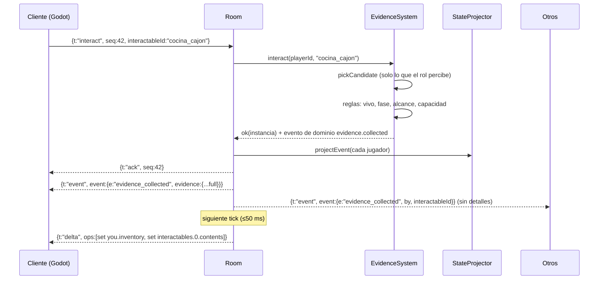

# Sincronización de estado en red

## Principios

1. **Servidor autoritativo.** El cliente solo envía *intenciones* (`ClientIntent`). Moverse, recoger, soltar, destruir, mostrar y votar se validan en el servidor contra `RoleManager` y `EvidenceSystem`.
2. **Información por jugador.** En un juego de deducción, filtrar *qué sabe cada uno* es tan importante como sincronizar posiciones. Nunca se difunde el estado crudo: `StateProjector` construye una vista distinta para cada jugador (roles ajenos ocultos, pruebas según visibilidad del rol, inventario privado).
3. **Dos canales lógicos sobre un mismo socket:**

| Canal | Mensaje | Cuándo | Contenido |
|---|---|---|---|
| Estado continuo | `delta` (o `snapshot` inicial) | Cada tick (20 Hz), solo si algo cambió para ese jugador | Posiciones, fase, contenido visible de objetos, tu inventario/objetivos |
| Eventos discretos | `event` | Inmediato, en el momento del hecho | Alguien recogió/soltó/destruyó/mostró algo, cambio de fase, votos, fin de partida |
| Confirmación | `ack` / `rejected` | Respuesta a cada intención (por `seq`) | Permite feedback inmediato y reconciliación |

## Flujo de una recogida de prueba

## Versionado y deltas

- `RoomState.version` sube con cada cambio aceptado.
- Para cada jugador el servidor guarda el último snapshot proyectado que le envió. En cada tick proyecta uno nuevo, calcula el diff (`JsonDeltaEncoder`) y envía `delta {from, to, ops}` solo si hay operaciones.
- Como el diff se hace **después** de filtrar, un delta nunca puede filtrar información oculta.
- El cliente (`GameState.gd`) aplica las `ops` en orden. Si detectara un hueco de versiones, pide (o recibe) un `snapshot` completo. *Pendiente: intent `resync`.*

## Movimiento

- El cliente local se mueve con predicción y envía `move` a 20 Hz.
- El servidor rechaza saltos imposibles (`too_fast`, margen 1.5× la velocidad máxima). La posición autoritativa vuelve por delta y `Player.gd` corrige si la desviación supera `SNAP_DISTANCE`.
- Jugadores remotos se interpolan hacia su última posición conocida.

## Salas

- `join` lleva `roomCode` opcional; `RoomDirectory` enruta cada conexión a su sala y la crea si no existe. Cada sala es independiente (roles, pruebas, juicio).
- El `welcome` devuelve el código normalizado (`abcd` → `ABCD`).

## Fases de sala

`lobby → briefing → investigation → discussion → voting → results`

- `lobby`: al estar todos `ready` y haber `minPlayers`, se asignan roles en secreto.
- Las reglas de `EvidenceSystem` usan la fase: recoger/destruir y las acciones canalizadas (`channel_start`) solo en `investigation`; exponer en `discussion`/`voting`.
- `snapshot.trial` lleva la mesa pública, las opciones, quién ha votado (no a qué) y tu voto.
- En `results` `GameResolution` calcula veredicto, finales y ganadores; llega en `trial.resolution` y en el evento `game_over`, y se revelan todos los roles.

## Reconexión y desconexión

- En `lobby`: el jugador se elimina.
- En partida: queda `connected:false`, sus pruebas caen en el objeto libre más cercano (`spillInventory`) y conserva el rol si vuelve.

## Escalado (siguiente paso)

- `IClientTransport` aísla WebSocket: se puede sustituir por WebRTC, ENet o Colyseus sin tocar `Room`.
- `IDeltaEncoder` permite pasar a un formato binario (MessagePack/FlatBuffers).
- Una sala por proceso hoy; para muchas salas, un `RoomRegistry` + *matchmaker* y `IInventoryStore` respaldado en Redis.
